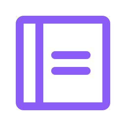
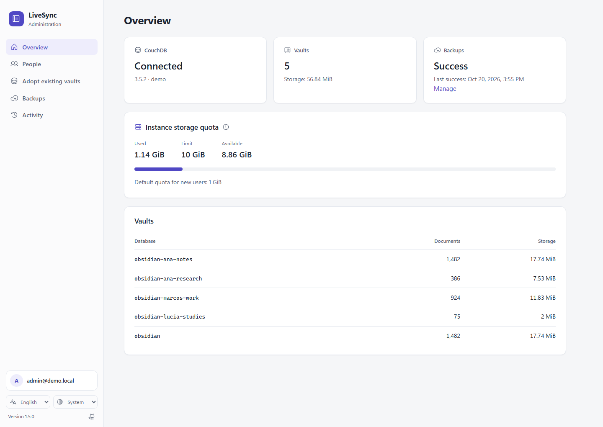
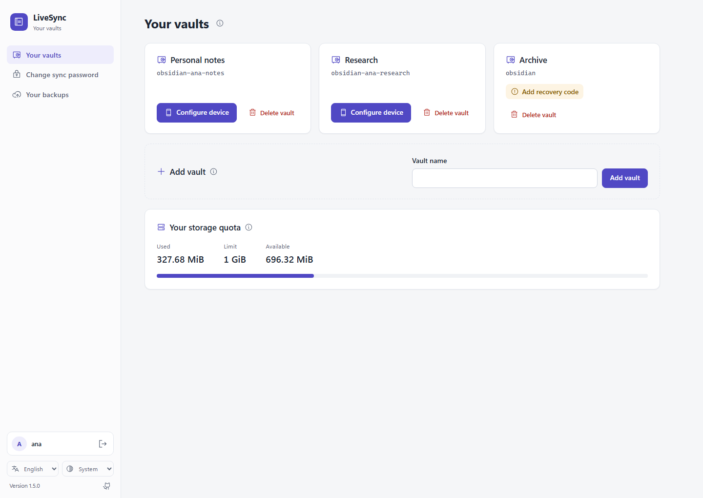

<p align="center">
  
</p>

# Obsidian LiveSync Dashboard

A self-hosted web panel for the CouchDB server behind
[Obsidian LiveSync](https://github.com/vrtmrz/obsidian-livesync). Administrators create accounts
and set storage quotas. Owners set their sync password, generate encrypted setup URIs in their
browser and back up their vaults to their own Google Drive.

<p>
  <a href="https://ko-fi.com/K3Q5236GOO"></a>
</p>

The panel has two portals, both reachable only through Tailscale. The interface is in English and
Spanish, with light and dark themes.

**[Documentation site](https://alexadiaconitei.github.io/obsidian-live-sync-dashboard/)** ·
[Run the demo locally](#run-the-demo-locally) · [Deploy with Dokploy](#deploy-with-dokploy) ·
[Docker Compose](#deploy-with-docker-compose) · [Backups](#backups) · [Documentation](#documentation)



_The local demo, with fictional people, vaults, usage and backups._

<details>
<summary>Owner portal preview</summary>



_Owners see only their own vaults and configure each device separately._

</details>

> [!NOTE]
> Parts of the code and documentation in this repository were written with AI assistance, using
> GPT 6.1-Sol and Claude Opus 5.5.

## What you can do

- Invite people to their own accounts. Each person creates and manages their vaults.
- Adopt existing databases. Names, account passwords and security memberships stay as they are.
- Disable access, reset credentials and finish interrupted provisioning from the admin portal.
- Limit storage per person and for the whole instance. The sync gateway rejects writes over the
  limit.
- Generate password-protected setup URIs in the settings format of the pinned LiveSync version.
- Download a recovery ZIP of a vault, then delete the vault. Both steps ask for confirmation.
- Schedule encrypted CouchDB backups, request one by hand and read their status and history.
- Let each owner connect their Google Drive, pick a folder and back up their vaults daily or on
  demand, encrypted to their own age key.

Automated tests cover CouchDB integration, browser onboarding, setup URI generation and container
deployment. Some checks still need real accounts and devices: Google OAuth and folder selection,
sync on Windows and iPhone, live Tailscale grants and restoring production-sized vaults. See
[test coverage and remaining checks](docs/testing.md).

## Run the demo locally

Use Node.js 24.21.0 or a later 24.x release (see [.nvmrc](.nvmrc)) and pnpm 12.8.2 (pinned in
`packageManager`). From the checkout:

```sh
pnpm install --frozen-lockfile
pnpm run build
pnpm run demo
```

Open [administration](http://127.0.0.1:5173) or the [owner portal](http://127.0.0.1:5174) and sign
in as `ana` with `demo-owner-password`. The demo needs no CouchDB server or Tailscale account. Its
data lives in memory and is lost when the process stops, and its instance backups are simulated.
Personal Google Drive backups are off. Use test passwords only, and stop it with Ctrl+C.

With the demo running, `pnpm run screenshots` regenerates the screenshots in this README and on the
documentation site. It needs Playwright's Chromium (`pnpm exec playwright install chromium`).

## Deploy with Dokploy

Dokploy pulls the images from GitHub Container Registry. GitHub Actions builds and tests them, so
the deployment host builds nothing.

You need Linux amd64 with Docker Compose 2.23.1 or later, a tailnet with MagicDNS and HTTPS
enabled, and an auth key allowed to advertise `tag:notes`. A complete installation also needs a
public [age](https://age-encryption.org/) recipient and an rclone destination. Keep the private age
key offline.
[Before you install](https://alexadiaconitei.github.io/obsidian-live-sync-dashboard/docs/install/prepare/)
shows how to prepare each of these.

1. Download `compose.dokploy.yml` and `dokploy.env.example` from a published GitHub release. The
   environment file pins both images to their published digests.
2. If the GHCR packages are private, add the registry in Dokploy with a classic GitHub PAT that has
   `read:packages` and access to both packages.
3. Create a **Docker Compose** service with the **Raw** provider. Paste the Compose file, and put
   the environment values in Dokploy's Environment editor.
4. Set `TS_FQDN` to the node's Tailscale DNS name and replace every credential and backup
   placeholder. Review the tailnet access policy.
5. Use the deployment command from
   [the Dokploy guide](https://alexadiaconitei.github.io/obsidian-live-sync-dashboard/docs/install/dokploy/#create-the-service).
   It disables builds, waits for the health checks and recreates every container that shares the
   Tailscale network namespace.

[deploy/compose.dokploy.yml](deploy/compose.dokploy.yml) has no build contexts, source mounts or
host ports. The image names in [deploy/.env.dokploy.example](deploy/.env.dokploy.example) are
placeholders. Take the images from a published release.

[The Dokploy guide](https://alexadiaconitei.github.io/obsidian-live-sync-dashboard/docs/install/dokploy/)
covers registry settings, the exact commands, access checks, updates and troubleshooting.

## Deploy with Docker Compose

The complete stack runs Tailscale, CouchDB, the panel and a separate backup worker. Docker builds
the panel and the worker from this checkout. The Linux, Compose, Tailscale and backup requirements
are the same as for Dokploy.

```sh
cp deploy/.env.example deploy/.env
chmod 600 deploy/.env
```

Replace the placeholders in `deploy/.env`. Set the three public URLs to the node's Tailscale DNS
name with the ports in [First use](#first-use). Then merge [the example policy](deploy/tailscale/policy.hujson)
into your tailnet policy, keeping any rules your monitors need.

```sh
docker compose -p livesync --env-file deploy/.env -f deploy/compose.yml config --quiet
docker compose -p livesync --env-file deploy/.env -f deploy/compose.yml up -d --build --wait --wait-timeout 180
```

Keep the same project name on updates. Named volumes hold the CouchDB data, the Tailscale identity,
the rclone configuration and the backup state. See
[Docker Compose](https://alexadiaconitei.github.io/obsidian-live-sync-dashboard/docs/install/docker-compose/)
and [Updating](https://alexadiaconitei.github.io/obsidian-live-sync-dashboard/docs/install/updating/)
for prebuilt images and recreating containers without losing data.

### Connect an existing CouchDB server

Use [compose.existing.yml](deploy/compose.existing.yml) to build from source, or
[compose.dokploy.existing.yml](deploy/compose.dokploy.existing.yml) for the GHCR images. These
files add the panel and its own Tailscale node. They create no CouchDB volumes and no backup worker.

The existing server's URL must use HTTPS, and only the panel and trusted operators may reach it.
Point the sync clients at the panel's quota gateway before you adopt any vault, because adoption
installs a CouchDB write guard that rejects direct writes. Read
[Existing server](https://alexadiaconitei.github.io/obsidian-live-sync-dashboard/docs/install/existing-server/)
before you change client endpoints.

## First use

Connect your device to Tailscale. In the addresses below, replace `<TS_FQDN>` with the node's full
DNS name, such as `notes.tail123456.ts.net`:

| Address                  | Purpose                          |
| ------------------------ | -------------------------------- |
| `https://<TS_FQDN>`      | LiveSync sync gateway, HTTPS 443 |
| `https://<TS_FQDN>:8443` | Administrator portal             |
| `https://<TS_FQDN>:9443` | Owner portal                     |

1. Open the administrator portal with a Tailscale login listed in `PANEL_ADMINS`.
2. Create an account with a display name and a CouchDB username, then create an invitation.
3. Send the invitation link to its owner privately. It works once and expires after 24 hours. The
   owner chooses or generates a password and can download the account details as a .txt file.
4. The owner signs in with the username and that sync password, then adds a vault by name. Several
   owners may share one Tailscale account; the panel does not use the Tailscale identity to decide
   which vaults someone owns.
5. In **Configure device**, the owner enters the sync password and generates an encryption
   passphrase for the new vault. For an existing vault, they reuse its original passphrase. The
   panel checks the sync password with CouchDB before the browser builds the URI.
6. The owner downloads the setup .txt before leaving the page. It holds the URI, every credential
   and the recovery code in plain text, so it must stay private. Closing the page clears the URI
   from the browser, even a persistent one. The panel cannot recover encryption passphrases.
7. Import the URI into Obsidian LiveSync, then check that notes and attachments sync, using test
   data.

Owners always sign in with their CouchDB username and sync password. Active accounts sign in
without changes to their vaults. Pending and reset accounts need an invitation first. The admin
portal always requires a Tailscale identity listed in `PANEL_ADMINS`. An owner session ends after
one hour without activity, or 12 hours after sign-in. Changing or resetting the password, disabling
access and signing out end all earlier sessions.

When adding a device, reuse the vault's encryption passphrase from the other devices. An adopted
vault without a recovery code cannot produce setup URIs. The owner's vault card then shows an
**Add recovery code** button, and the admin's person page shows a form. Read the code from an
Obsidian client that already syncs the vault:

```sh
pnpm run recovery-code "<vault>/.obsidian/plugins/obsidian-livesync/data.json"
```

LiveSync stores the key encrypted, so `idDerivationKey` in that file is empty. Paste the whole
`sls-id-v1:…` value. The panel never makes up a new identity for the vault.

## Backups

The instance backup worker copies the CouchDB data directory, including user accounts and the
panel registry, so the administrator can rebuild the server. It encrypts each archive to the
configured age recipient and uploads it to an rclone destination: Google Drive, S3-compatible
storage such as AWS S3, MinIO or Garage, or any other rclone remote. An optional second worker
sends archives to another destination on its own schedule and retention. See
[Instance backups](https://alexadiaconitei.github.io/obsidian-live-sync-dashboard/docs/backups/instance/).

Personal backups export only one owner's vaults, to that owner's Google Drive. Each owner gives the
panel a public age recipient and keeps the private key on their device or in a password manager.
The server never asks for the private key. The export holds the vault documents, attachments and
recovery identities, but no accounts or panel settings. It recovers notes. Rebuilding the server
needs the instance backup and the deployment secrets.

### Set up personal Google Drive backups

The administrator configures the Google application once, by setting `GOOGLE_DRIVE_CLIENT_ID`,
`GOOGLE_DRIVE_CLIENT_SECRET` and `GOOGLE_DRIVE_TOKEN_KEY`. Keep the same token key across upgrades.
The folder picker also needs `GOOGLE_DRIVE_PICKER_API_KEY` and `GOOGLE_DRIVE_PROJECT_NUMBER`.
[The Google setup guide](https://alexadiaconitei.github.io/obsidian-live-sync-dashboard/docs/backups/personal/#configure-the-server-once)
lists the APIs to enable, the exact OAuth callback and the browser key restrictions. The production
image includes age. Source installations need `age` on PATH.

In the owner portal, the owner opens **Your backups**, connects a Google account and saves a public
age recipient. Backups go to `My Drive / obsidian-livesync-backups` by default. With the picker
configured, the owner can choose another folder they own, or go back to the default. Earlier
copies stay in the folder they were written to.

Owners can request a backup at any time or turn on automatic backups. An automatic backup runs 24
hours after the last successful one, and retries every hour after a failure. Retention defaults to
30 days. It moves to the Drive trash only the owner's backups in the current folder. Read
[Owner setup](https://alexadiaconitei.github.io/obsidian-live-sync-dashboard/docs/backups/personal/#owner-setup)
and test a restore before relying on a copy.

## Encryption

Setup URIs from the panel turn on LiveSync end-to-end encryption and path obfuscation. Obsidian
then encrypts notes before it sends them to CouchDB. A CouchDB administrator cannot read the note
contents, but can still see records, sizes and some metadata. Existing and adopted vaults keep
their previous settings, so check encryption in their Obsidian clients.

The vault encryption passphrase and the setup URI password never leave the browser. The URI
password protects the setup link, and the vault passphrase protects the synced content. CouchDB
credentials do pass through the panel during activation, sign-in, password changes and the sync
password check before URI generation. The browser runs the JavaScript the panel serves, so a
compromised server could capture any secret typed into the page.

age encrypts the backup archives separately. Opening an archive needs its private age key. If the
vault uses end-to-end encryption, reading the notes inside also needs the vault's LiveSync
passphrase.

## Quotas and access

`INSTANCE_QUOTA_GIB` limits active data across all ordinary CouchDB databases, including those the
panel has not adopted. System databases and the panel registry do not count.
`DEFAULT_USER_QUOTA_GIB` is the starting limit for new people. Admins can change each person's
limit in the portal. Both accept up to three decimal places, and `0` means no limit, though the
instance limit still applies. The example environment sets 10 GiB for the instance and 1 GiB per
person.

The quota counts active document JSON, attachments and live conflict revisions. Old revisions,
indexes, database files and backups take extra disk space on top. Read
[Quotas](https://alexadiaconitei.github.io/obsidian-live-sync-dashboard/docs/guides/quotas/) before
you change limits on an existing installation.

Run exactly one panel instance against a CouchDB server. Keep CouchDB and every backend listener on
loopback. Tailscale Serve exposes only the three HTTPS endpoints and sends the identity headers the
admin portal relies on. Keep Funnel off, and do not route the backends through public Traefik
routes. A public deployment is planned; see the [roadmap](ROADMAP.md).

## Development

The backend is Node.js 24, Hono and TypeScript. Production runs the compiled JavaScript under Node's
permission model. Development scripts and tests run through `tsx`. The server renders the HTML,
with htmx, browser scripts served by the panel and Tailwind CSS.

```sh
pnpm install --frozen-lockfile
pnpm run verify
pnpm run audit
pnpm run build
```

`verify` checks formatting, lint and types, then runs the tests. Set `TEST_COUCHDB_URL`,
`TEST_COUCHDB_USER` and `TEST_COUCHDB_PASSWORD` to run the integration tests against a disposable
CouchDB. The encryption tests and the full owner browser flow need `age` and `age-keygen` on PATH.
Browser tests run separately:

```sh
pnpm exec playwright install --with-deps chromium firefox webkit
pnpm run test:browser
```

[Testing](docs/testing.md) describes the fixture and the platform requirements. CI and the release
workflow also test the production containers, backup encryption, a full Compose start, recreating
containers with the same volumes, and image vulnerabilities.

## Documentation

The installation, operation and backup guides are on the
**[documentation site](https://alexadiaconitei.github.io/obsidian-live-sync-dashboard/)**. This
repository keeps the developer notes:

| Guide                        | Covers                                                        |
| ---------------------------- | ------------------------------------------------------------- |
| [Testing](docs/testing.md)   | Local fixtures, browser tests and the remaining manual checks |
| [Releases](docs/releases.md) | Version checks, GHCR publishing and the Dokploy release files |

The dependency policy is in
[Development](https://alexadiaconitei.github.io/obsidian-live-sync-dashboard/docs/reference/development/#dependency-policy).

This project is not affiliated with Obsidian or the Obsidian LiveSync maintainers.

## About Me


**Alex Adiaconitei**

Software engineer. At work I do backend with Java and Spring Boot; at home I build my own tools in TypeScript, Rust or whatever each problem needs, and I run a VPS and a homelab to learn infrastructure.

<br clear="left">

- Software Engineer
- TypeScript, Rust, Java, Python
- Remote

<p>
  <a href="https://github.com/AlexAdiaconitei"></a>
  <a href="https://www.linkedin.com/in/alexadiaconitei/"></a>
  <a href="https://ko-fi.com/K3Q5236GOO"></a>
</p>
